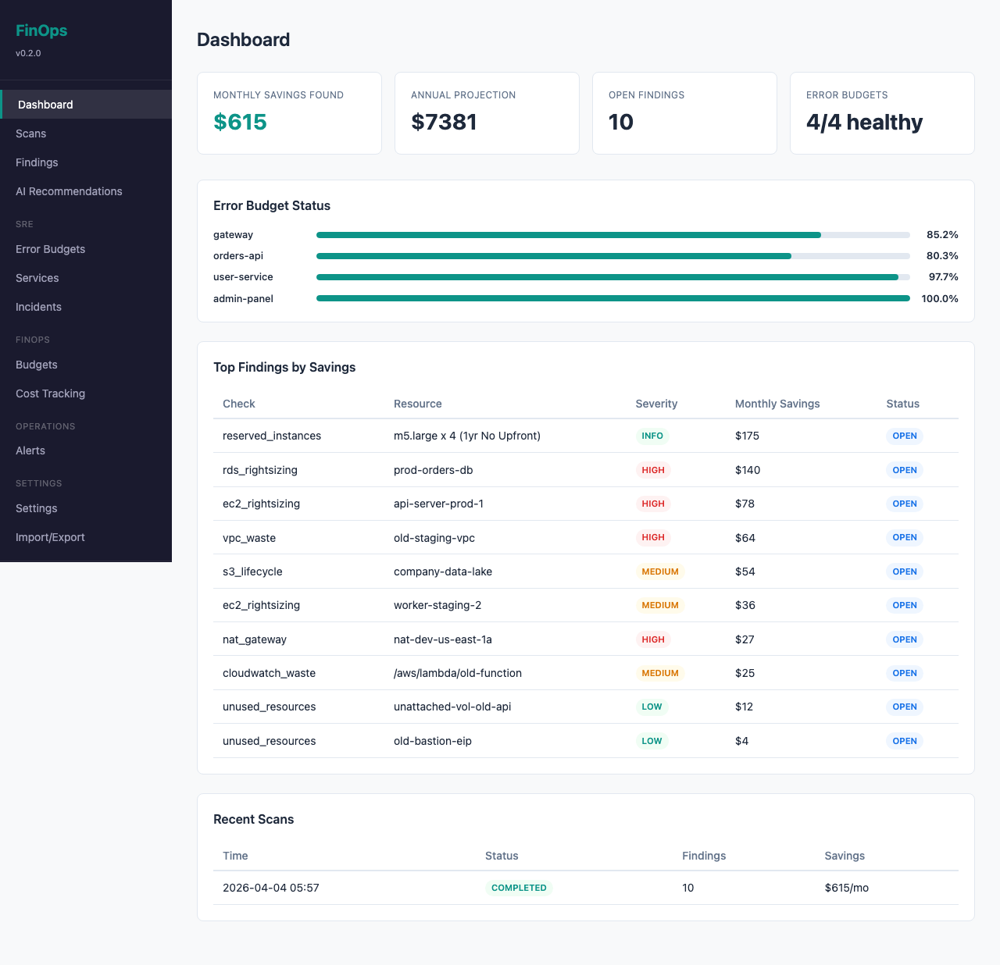
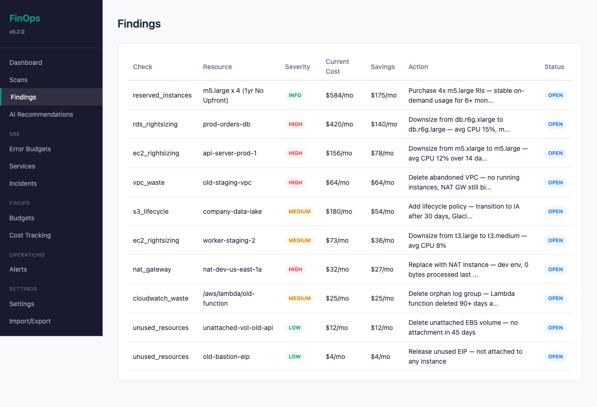
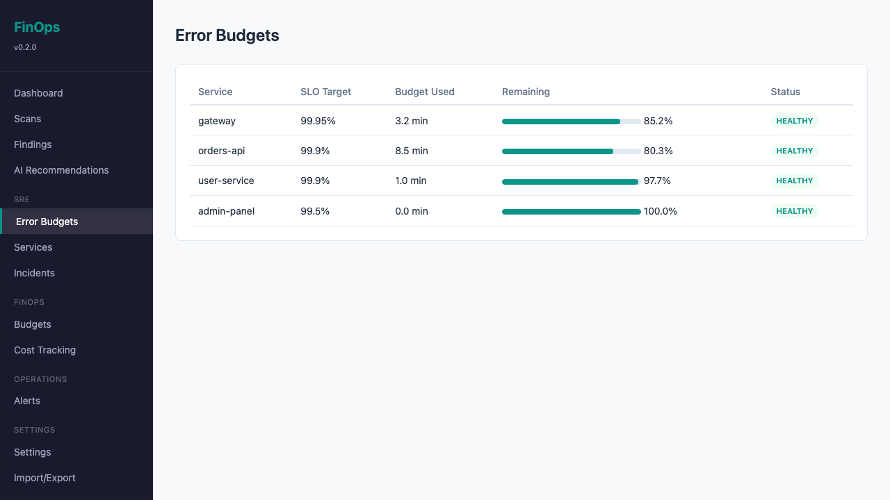
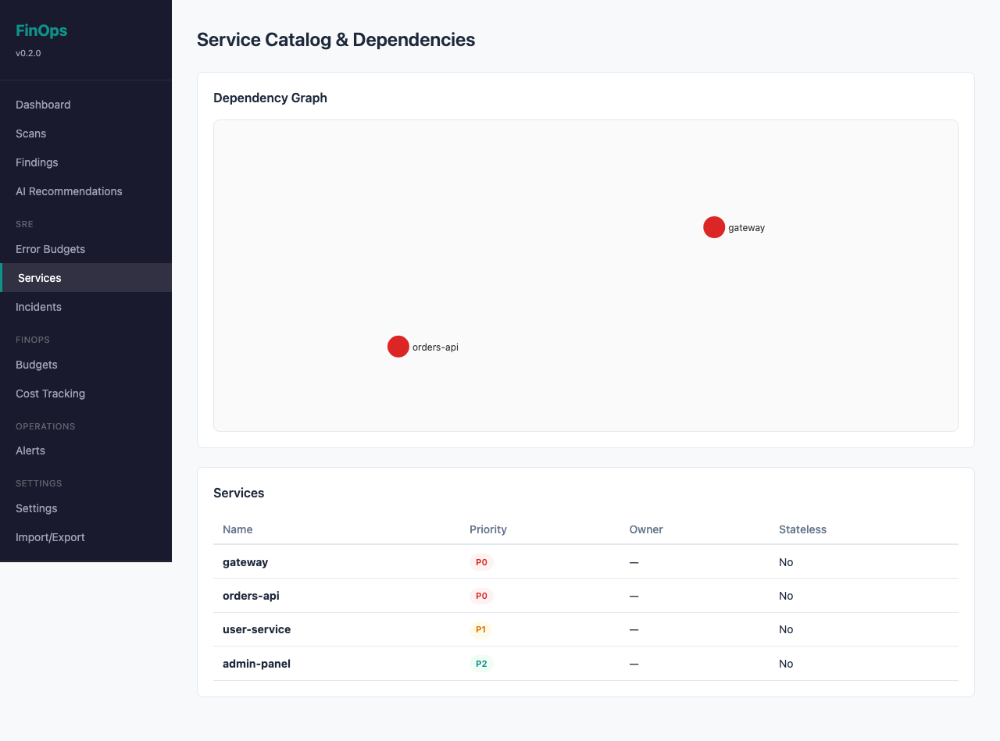

# aws-finops-toolkit

**SRE + FinOps Platform — cost optimization gated on error budgets, traffic analysis, and dependency safety.**

[](https://github.com/JIUNG9/aws-finops-toolkit/actions/workflows/ci.yml)
[](https://python.org)
[](LICENSE)
[](tests/)

CLI + web dashboard that puts an SRE gate in front of cost optimization: SLOs, error
budgets and service dependencies get checked *before* anything is recommended for
cutting.

> ### Status: the safety layer is built, the scanner set is small
>
> **All 4 cost checks query AWS; `s3_lifecycle` does so only for buckets with no lifecycle rule.**
> The checks are `nat_gateway`, `elasticache_scheduling`, `unused_resources` and `s3_lifecycle`.
> Each is covered by moto-backed tests that assert on real findings. Checks for EC2 and RDS
> right-sizing and Spot candidates were removed because they never called AWS.
>
> Also working: the FastAPI + HTMX dashboard, the error-budget safety gate, the pluggable
> LLM backend, the report writers (CSV/XLSX/HTML) and `--demo` mode against fixture data.
> `pytest --collect-only -q` collects 132 tests.
>
> Use `finops dashboard --demo` to see the interface. Against a real account, only the
> live checks produce findings.

---

## Why This Exists

Most FinOps tools tell you *what* to cut. They don't tell you *if it's safe*.

**Accepting a finding runs a safety analysis.** Setting a finding to `accepted` through the API or
dashboard runs the steps below and stores the result in `safety_analyses`.

1. **Traffic Analysis** — no traffic metrics are collected yet. Resources above $200/month get a
   `caution`; everything else is reported as `unknown`.
2. **Dependency Check** — counts the services that the service owning the resource depends on
   (0 is `safe`, 1-2 `caution`, 3 or more `unsafe`).
3. **Error Budget Gate** — reads only the error budgets of the service that owns the resource
   (`service_resources`). A `breached` budget is `unsafe` and blocks the accept with HTTP 409;
   `warning` or `critical` is `caution`. A resource with no owning service or no budget is `unknown`.
4. **AI Analysis** — runs only when an LLM is passed in, which the accept path does not do yet, so
   this step is `unknown` there. An LLM error is recorded in the verdict, not hidden.
5. **User Confirmation** — checklist stored with the analysis; nothing enforces it yet.

Only `unsafe` blocks. `caution` and `unknown` are stored and let the accept through. The budgets
come from the database, which nothing fills from a live SLO source yet.

## Quick Start

```bash
# Install
pip install aws-finops-toolkit[web]

# Launch dashboard with demo data (no AWS creds needed)
finops dashboard --demo

# Scanning a real account runs, but returns no findings yet — see Status above
finops scan --profile production
```

Open `http://localhost:8080` to see the dashboard.

## Screenshots

### Dashboard — Cost overview, error budget status, top findings


### Findings — Filterable table with severity, savings, and inline actions


### Error Budgets — SLO targets with burn rate tracking per service


### Services — Service catalog with D3.js dependency graph


## Features

### Web Dashboard (HTMX + Chart.js)
- **Cost dashboard** — before/after comparison, trends, per-account breakdown
- **Findings** — filterable table with severity, accept/dismiss/watch actions
- **Error budget tracking** — set SLO targets, track burn rate, incident timeline
- **Financial budgets** — budget vs actual, forecast, AI advice
- **Service dependency graph** — D3.js interactive visualization
- **AI recommendations** — pluggable LLM (Claude/OpenAI) with safety analysis
- **Incident tracking** — record incidents, track user churn impact

### CLI (preserved from v0.1)
```bash
finops scan --profile prod                    # Scan AWS account
finops scan --profiles dev,staging,prod       # Multi-account scan
finops report --format html --output report.html
finops dashboard                              # Launch web UI
finops dashboard --demo                       # Demo mode (no AWS creds)
```

### 4 Cost Checks

All four query AWS and are tested against moto. `s3_lifecycle` reports only buckets with no
lifecycle rule; it has no other sub-checks.

| Check | What it finds |
|-------|--------------|
| `nat_gateway` | ✅ **live** — NAT Gateways in dev/staging, and unused ones with 0 bytes processed |
| `unused_resources` | ✅ **live (EBS + EIP + snapshots + LBs + stopped instances)** — unattached EBS volumes, unassociated Elastic IPs, old snapshots and idle ALBs/NLBs, and instances stopped for more than 7 days |
| `elasticache_scheduling` | ✅ **live** — non-prod clusters and replication groups running 24/7 |
| `s3_lifecycle` | ✅ **live** — large S3 buckets without lifecycle policies |

### Cloud support
AWS only. The provider layer has an abstraction, and no other provider is implemented.

### Pluggable AI
Bring your own LLM API key:
```yaml
# finops.yaml
llm:
  provider: claude    # or 'openai'
  api_key_env: ANTHROPIC_API_KEY
```

## Architecture

```
Browser (HTMX + Chart.js + D3.js)
    │
FastAPI Application
    ├── HTMX Pages (11 server-rendered pages)
    ├── REST API (/api/v1/* — 23+ endpoints)
    ├── SSE Events (async scan progress)
    │
    ├── Service Layer
    │   ├── ScannerService      — async scan orchestration
    │   ├── ErrorBudgetService  — SLO tracking + burn rate
    │   ├── BudgetService       — financial budget + forecast
    │   ├── CostService         — trends, comparison
    │   ├── SafetyAnalyzer      — traffic + deps + error budget gate
    │   └── AI Recommendations  — pluggable LLM (Claude/OpenAI)
    │
    ├── Provider Layer
    │   └── AWS (boto3)
    │
    └── SQLite (aiosqlite) — 16 tables, zero setup
```

## Tech Stack

| Component | Technology |
|-----------|-----------|
| Backend | Python 3.10+, FastAPI, uvicorn |
| Frontend | Jinja2, HTMX, Chart.js, D3.js |
| Database | SQLite (aiosqlite) — zero config |
| Cloud | boto3 (AWS) |
| AI | Anthropic Claude / OpenAI (pluggable) |
| CLI | Click + Rich |
| Testing | pytest (moto is a declared dependency but the current tests use plain fixtures) |

## Configuration

```yaml
# finops.yaml
accounts:
  - profile: production
    name: Production
  - profile: staging
    name: Staging

thresholds:
  ec2_cpu_avg_percent: 20
  snapshot_age_days: 90
  unattached_volume_grace_days: 7   # skip unattached EBS volumes younger than this

web:
  host: 127.0.0.1
  port: 8080

llm:
  provider: claude
  api_key_env: ANTHROPIC_API_KEY

database:
  path: ~/.finops/finops.db
```

## API

Full OpenAPI docs available at `http://localhost:8080/docs` when running.

Key endpoints:
```
GET  /api/v1/health                    Health check
POST /api/v1/accounts                  Add cloud account
POST /api/v1/scans                     Trigger scan
GET  /api/v1/findings                  List findings (filterable)
POST /api/v1/error-budgets             Set SLO target
GET  /api/v1/costs/overview            Cost summary
POST /api/v1/ai/analyze                Run AI analysis
GET  /api/v1/services/dependency-graph D3.js graph data
POST /api/v1/incidents                 Record incident + user impact
```

## Roadmap

In order of what unblocks the most:

1. **Pricing from the API.** Several modules carry a hardcoded price table with a
   `TODO: Fall back to AWS Pricing API`. Fine for a demo, wrong the moment a region or
   instance family isn't in the table.
2. **A pre-change safety check against live resources.** The old `finops preflight` command was removed because it printed a verdict without querying AWS.

## Development

```bash
git clone https://github.com/JIUNG9/aws-finops-toolkit.git
cd aws-finops-toolkit
python -m venv .venv && source .venv/bin/activate
pip install -e ".[dev,web]"
pytest
```

## Blog Series

This tool is the companion code for the **"FinOps for SREs"** article series:

- [Part 1: How I Found $12K/Year in AWS Waste](https://medium.com/@June-Gu)
- Part 0: Pre-Flight: 9 Checks Before Cutting Costs
- Part 2: Downsizing Without Downtime

Read the full series on [Medium](https://medium.com/@June-Gu).

## License

MIT

## Author

**June Gu**, Site Reliability Engineer · https://github.com/JIUNG9

Building reliable infrastructure at scale.

- [Medium](https://medium.com/@June-Gu)
- [GitHub](https://github.com/JIUNG9)
