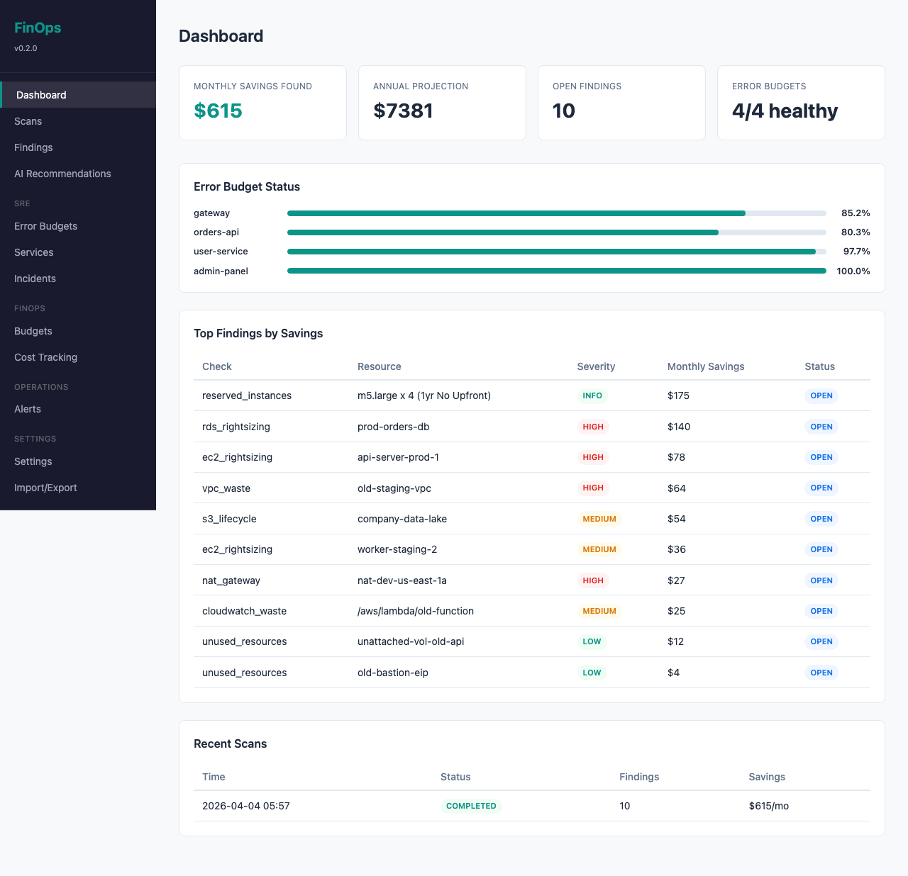
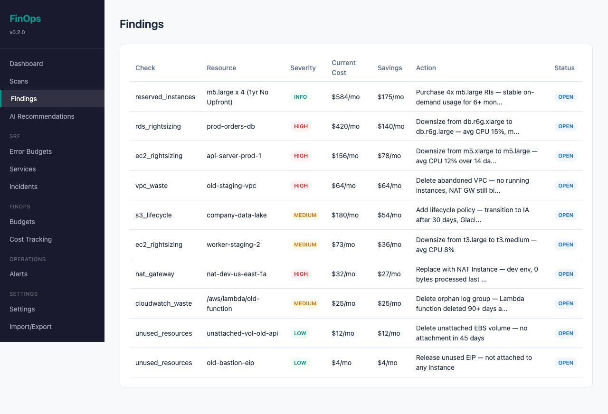
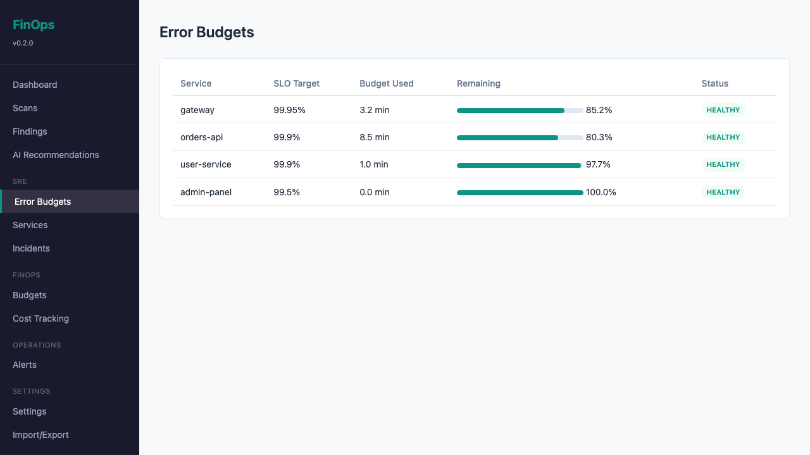
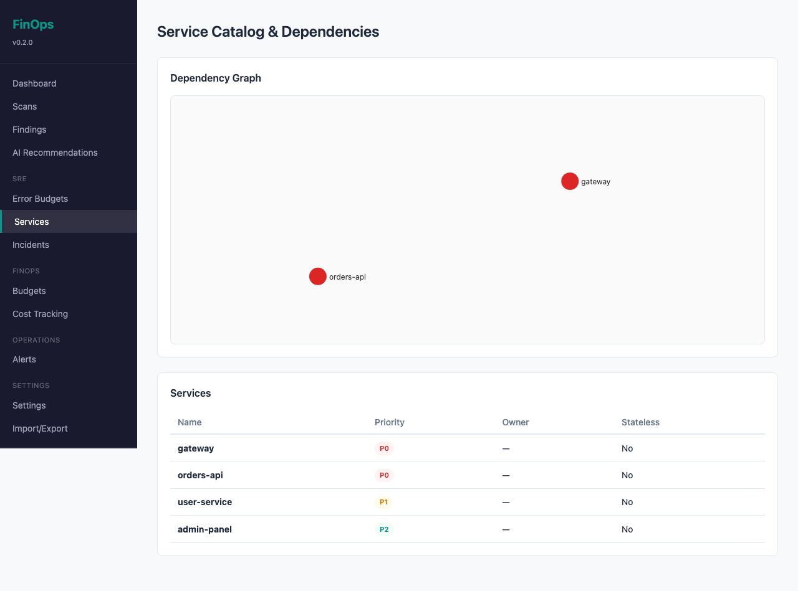

# aws-finops-toolkit

**SRE + FinOps Platform — cost optimization gated on error budgets, traffic analysis, and dependency safety.**

[](https://github.com/JIUNG9/aws-finops-toolkit/actions/workflows/ci.yml)
[](https://python.org)
[](LICENSE)
[](tests/)

CLI + web dashboard that puts an SRE gate in front of cost optimization: SLOs, error
budgets and service dependencies get checked *before* anything is recommended for
cutting. The design comes out of real FinOps work that identified ~$67K/year across 4
AWS accounts without a production incident.

> ### ⚠️ Status: the safety layer is built, the scanners are not
>
> **3 of 10 cost checks query AWS. The other 7 do not yet.** `nat_gateway` (2026-08-07),
> `elasticache_scheduling` and `unused_resources` (both 2026-10-18) are live, with moto-backed
> tests asserting on real findings. `unused_resources` covers unattached EBS volumes only so far;
> its EIP, snapshot, idle load balancer and stopped instance parts are still scaffolded. Each
> scaffolded module has its pricing tables, thresholds and helper logic implemented and tested,
> and its boto3 calls written out but commented behind `# TODO: Uncomment and implement`.
> `finops scan` runs end to end and only returns findings from those three checks.
>
> What *is* working: the FastAPI + HTMX dashboard (62 routes, 14 templates), the
> error-budget safety gate, the pluggable LLM backend, the report writers (CSV/XLSX/
> HTML), and `--demo` mode against fixture data. 84 tests pass, covering the framework,
> the pricing helpers, the API surface, and moto-backed tests for the two live checks.
>
> Use `finops dashboard --demo` to see the interface. Against a real account, only NAT
> Gateways and unattached EBS volumes will show up; the other eight checks still return
> nothing. Wiring them up is the next piece of work, and it's tracked in the roadmap below.

---

## Why This Exists

Most FinOps tools tell you *what* to cut. They don't tell you *if it's safe*.

No existing tool combines SRE reliability (error budgets, SLOs) with cost optimization. Sedai is autonomous but opaque. Harness CCM has budgets but no error budget gating. This fills the gap.

**Every recommendation passes a 5-step safety analysis:**

1. **Traffic Analysis** — 1-year traffic patterns, seasonal peaks, growth trends
2. **Dependency Check** — what services break if this resource fails? Blast radius?
3. **Error Budget Gate** — if error budget < 50%, all optimizations are blocked
4. **AI Analysis** — LLM explains risk, suggests timing, provides rollback plan
5. **User Confirmation** — checklist approval before any action

## Quick Start

```bash
# Install
pip install aws-finops-toolkit[web]

# Launch dashboard with demo data (no AWS creds needed)
finops dashboard --demo

# Scanning a real account runs, but returns no findings yet — see Status above
finops scan --profile production
```

Open `http://localhost:8080` to see the dashboard.

## Screenshots

### Dashboard — Cost overview, error budget status, top findings


### Findings — Filterable table with severity, savings, and inline actions


### Error Budgets — SLO targets with burn rate tracking per service


### Services — Service catalog with D3.js dependency graph


## Features

### Web Dashboard (HTMX + Chart.js)
- **Cost dashboard** — before/after comparison, trends, per-account breakdown
- **Findings** — filterable table with severity, accept/dismiss/watch actions
- **Error budget tracking** — set SLO targets, track burn rate, incident timeline
- **Financial budgets** — budget vs actual, forecast, AI advice
- **Service dependency graph** — D3.js interactive visualization
- **AI recommendations** — pluggable LLM (Claude/OpenAI) with safety analysis
- **Incident tracking** — record incidents, track user churn impact

### CLI (preserved from v0.1)
```bash
finops scan --profile prod                    # Scan AWS account
finops scan --profiles dev,staging,prod       # Multi-account scan
finops preflight --target prod-orders-db      # Pre-flight safety check
finops report --format html --output report.html
finops dashboard                              # Launch web UI
finops dashboard --demo                       # Demo mode (no AWS creds)
```

### 10 Cost Checks — 2 live, 8 scaffolded

`nat_gateway`, `elasticache_scheduling` and the unattached-EBS part of `unused_resources` are
wired up and tested against moto. The rest have their thresholds,
pricing lookups and helper logic implemented and under test, with the boto3 calls written
but commented out — those still return an empty result. The column says what each is
designed to find; ✅ marks the ones that actually do it.

| Check | Designed to find |
|-------|--------------|
| `ec2_rightsizing` | Over-provisioned instances (avg CPU < 20% over 14 days) |
| `nat_gateway` | ✅ **live** — NAT Gateways in dev/staging, and unused ones with 0 bytes processed |
| `spot_candidates` | Non-prod workloads eligible for Spot instances |
| `unused_resources` | ✅ **live (EBS only)** — unattached EBS volumes. Unused EIPs, old snapshots, idle ALBs and stopped instances still scaffolded |
| `reserved_instances` | On-demand instances that should be RIs |
| `elasticache_scheduling` | ✅ **live** — non-prod clusters and replication groups running 24/7 |
| `rds_rightsizing` | Over-provisioned databases, non-prod Multi-AZ |
| `vpc_waste` | Abandoned VPCs, idle NAT GWs, stale WorkSpaces |
| `cloudwatch_waste` | Orphan log groups, infinite retention, high ingestion |
| `s3_lifecycle` | S3 buckets without lifecycle policies |

### Multi-Cloud
- **AWS** — 3 of 10 checks wired (`nat_gateway`, `elasticache_scheduling`, `unused_resources` EBS only); the rest scaffolded (see Status)
- **Azure** — provider abstraction only, no implementation
- **GCP** — provider abstraction only, no implementation

### Pluggable AI
Bring your own LLM API key:
```yaml
# finops.yaml
llm:
  provider: claude    # or 'openai'
  api_key_env: ANTHROPIC_API_KEY
```

## Architecture

```
Browser (HTMX + Chart.js + D3.js)
    │
FastAPI Application
    ├── HTMX Pages (11 server-rendered pages)
    ├── REST API (/api/v1/* — 23+ endpoints)
    ├── SSE Events (async scan progress)
    │
    ├── Service Layer
    │   ├── ScannerService      — async scan orchestration
    │   ├── ErrorBudgetService  — SLO tracking + burn rate
    │   ├── BudgetService       — financial budget + forecast
    │   ├── CostService         — trends, comparison
    │   ├── SafetyAnalyzer      — traffic + deps + error budget gate
    │   └── AI Recommendations  — pluggable LLM (Claude/OpenAI)
    │
    ├── Provider Layer (pluggable)
    │   ├── AWS (boto3 — calls written, commented out)
    │   ├── Azure (stub)
    │   └── GCP (stub)
    │
    └── SQLite (aiosqlite) — 16 tables, zero setup
```

## Tech Stack

| Component | Technology |
|-----------|-----------|
| Backend | Python 3.10+, FastAPI, uvicorn |
| Frontend | Jinja2, HTMX, Chart.js, D3.js |
| Database | SQLite (aiosqlite) — zero config |
| Cloud | boto3 (AWS) |
| AI | Anthropic Claude / OpenAI (pluggable) |
| CLI | Click + Rich |
| Testing | pytest (moto is a declared dependency but the current tests use plain fixtures) |

## Configuration

```yaml
# finops.yaml
accounts:
  - profile: production
    name: Production
  - profile: staging
    name: Staging

thresholds:
  ec2_cpu_avg_percent: 20
  snapshot_age_days: 90

web:
  host: 127.0.0.1
  port: 8080

llm:
  provider: claude
  api_key_env: ANTHROPIC_API_KEY

database:
  path: ~/.finops/finops.db
```

## API

Full OpenAPI docs available at `http://localhost:8080/docs` when running.

Key endpoints:
```
GET  /api/v1/health                    Health check
POST /api/v1/accounts                  Add cloud account
POST /api/v1/scans                     Trigger scan
GET  /api/v1/findings                  List findings (filterable)
POST /api/v1/error-budgets             Set SLO target
GET  /api/v1/costs/overview            Cost summary
POST /api/v1/ai/analyze                Run AI analysis
GET  /api/v1/services/dependency-graph D3.js graph data
POST /api/v1/incidents                 Record incident + user impact
```

## Roadmap

In order of what unblocks the most:

1. **Wire up the remaining 7 checks.** `nat_gateway` set the pattern; `elasticache_scheduling`
   and the unattached-EBS part of `unused_resources` followed it: uncomment the boto3 calls, keep
   the paginator, and add a `moto`-backed test per check that asserts on actual findings
   rather than `isinstance(results, list)`. Next up is the rest of `unused_resources`
   (EIPs, snapshots, idle LBs, stopped instances).
   CloudWatch is the one thing moto doesn't serve usefully here, so the tests stub that
   client and leave everything else real. Moto also doesn't paginate DescribeVolumes, so
   the EBS pagination test uses botocore's Stubber with a two-page NextToken response.
2. **Pricing from the API.** Several modules carry a hardcoded price table with a
   `TODO: Fall back to AWS Pricing API`. Fine for a demo, wrong the moment a region or
   instance family isn't in the table.
3. **`preflight` against live resources.** Same shape as the checks — no AWS calls yet.
4. **Then** the Azure and GCP providers, which are abstraction-only today.

## Development

```bash
git clone https://github.com/JIUNG9/aws-finops-toolkit.git
cd aws-finops-toolkit
python -m venv .venv && source .venv/bin/activate
pip install -e ".[dev,web]"
pytest
```

## Blog Series

This tool is the companion code for the **"FinOps for SREs"** article series:

- [Part 1: How I Found $12K/Year in AWS Waste](https://medium.com/@June-Gu)
- Part 0: Pre-Flight: 9 Checks Before Cutting Costs
- Part 2: Downsizing Without Downtime

Read the full series on [Medium](https://medium.com/@June-Gu).

## License

MIT

## Author

**June Gu** — Site Reliability Engineer at my employer. ex-e-commerce.

Building reliable infrastructure at scale. Relocating to Canada.

- [LinkedIn](https://linkedin.com/in/junegu)
- [Medium](https://medium.com/@June-Gu)
- [GitHub](https://github.com/JIUNG9)
